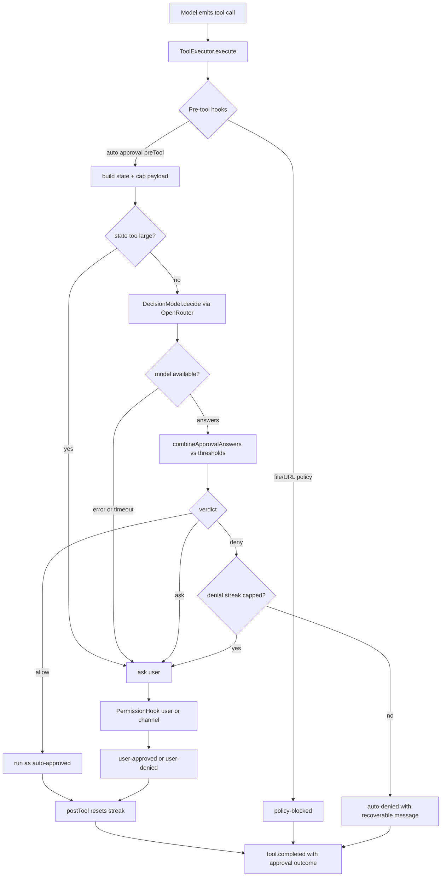

# Auto tool approval

Sonny can let a decision model judge each tool call instead of asking the user every time. In **auto** mode a pinned model (Jev) answers a fixed set of true/false questions about the pending call through OpenRouter's Decisions API, the answers are combined into an allow/deny/ask verdict against configured thresholds, and the call runs, is auto-denied with a recoverable message, or is escalated to the user. In **manual** mode every call asks the user as before. The feature is wired into the existing [tool executor and guardrails](../integrations/tools.md), rebuilt on [config hot-reload](../operations/configuration.md), and surfaced in the TUI through new tool-row labels.



The auto approval flow: policies deny first, then the decision model judges, then the verdict combiner and denial-streak cap decide whether to allow, auto-deny, or escalate to the user.

## Configuration

`toolApproval` is a top-level config block validated by `src/config/schemas/tool-approval.schema.ts` and registered in `src/config/schemas/index.ts` (`ToolApprovalConfigSchema.prefault({})`, so the block is optional and defaults fully). The bundled `src/config/config.yaml` ships a working auto-mode block.

| Field | Type | Default | Meaning |
| --- | --- | --- | --- |
| `mode` | `"auto" \| "manual"` | `"auto"` | `auto` judges with the decision model; `manual` asks the user for every call. |
| `model` | `string` | `"typesafe/jev-1.13"` | Pinned decision model on the OpenRouter Decisions API. |
| `timeoutMs` | positive int | `5000` | Per-call timeout; a timeout escalates to the user, never approves. |
| `maxConsecutiveDenials` | positive int | `3` | After this many auto denials in a row, the next would-be deny goes to the user. |
| `userMessageWindow` | positive int | `3` | How many recent user messages the decision model may see. |
| `maxPayloadChars` | positive int | `8000` | Character budget shared by the pending and previous call's parameters. |
| `thresholds.allow` | `{ maxDanger, minRequested }` | `{ 0.3, 0.6 }` | Both inclusive: allow when `danger ≤ maxDanger` and `requested ≥ minRequested`. |
| `thresholds.deny` | `{ minDanger, maxRequested }` | `{ 0.8, 0.3 }` | Both inclusive: deny when `danger ≥ minDanger` and `requested ≤ maxRequested`. |

`DEFAULT_TOOL_APPROVAL_CONFIG` (exported from the schema module) holds these defaults. Probabilities are validated to `[0, 1]`, counts/timeouts to positive integers, and the mode to the enum; an unknown mode, out-of-range threshold, or non-positive count fails parsing with "Invalid configuration" (see `parse-config.test.ts`). Because the schema uses `.prefault({})` on both the block and the nested `thresholds`, a missing `toolApproval` block yields the full auto-mode default, and partial overrides fill defaults around explicit values.

`toolApproval` is part of the [runtime config signature](../architecture/overview.md) (`createRuntimeConfigSignature()` in `src/runtime/runtime-config-signature.ts`), so changing the mode, model, thresholds, or any field rebuilds the live runtime through the `AgentSessionBuilder` and emits `config.reloaded` with `runtimeRebuilt: true`. Session defaults (`workspace`, `agentsPath`, `defaultAgent`) are still excluded as before.

## Decision model (Jev via OpenRouter Decisions API)

`src/tools/approval/decision-model.ts` defines the seam and the adapter:

- `DecisionModel` interface — `decide({ state, questions, signal? })` returns a `DecisionProbabilities` map (question id → probability in `[0,1]`). Implementations **reject rather than fabricate** an answer.
- `OpenRouterDecisionModel` — adapts `@openrouter/sdk`. It converts each question into a `noul` question (`{ type: "noul", instructions }`), calls `client.alpha.decisions.create({ decisionsRequest: { model, state, questions } })` with an `AbortSignal`, and maps each noul answer back to its probability.
- `DecisionsClient` — the SDK slice the adapter needs (`alpha.decisions.create`), injected through `OpenRouterDecisionModelOptions.client` so tests stub it without the real SDK.
- Timeout + abort — a `setTimeout(controller.abort(timeoutError), timeoutMs)` races the SDK call against `rejectOnAbort(controller.signal)`; an external `signal` forwards its abort reason into the controller. A timeout or SDK failure throws `DecisionModelError` (never resolves), and a missing/out-of-range probability for any asked question also throws.

The model is constructed in `createAgentSession()` (`src/runtime/create-agent-session.ts`) from `config.toolApproval` using `config.llm.apiKey` as the OpenRouter API key, so auto mode rides on the same key as the main LLM. It is rebuilt whenever the runtime config signature changes.

## Approval question set

`src/tools/approval/approval-questions.ts` defines the fixed propositions the decision model answers. Each `ApprovalQuestion` has an `id`, a `role` (`"intent" | "danger" | "informational"`), `instructions` (a stable true/false statement that references state fields by backticked path and never splices in values), and a `denialPhrase` used in the recoverable denial message.

`approvalQuestionsForTool(toolName)` returns the shared questions plus any tool-specific ones:

- **Shared** (`requested_by_user`, `involves_secrets`, `sends_local_data_out`) — asked for every tool. `requested_by_user` is the `intent` role and the only intent question.
- **bash** — `modifies_state` (informational, never decides), `destructive`, `elevates_privileges`, `executes_remote_code`.
- **writeFile** / **editFile** — `targets_system_or_dotfile`, `removes_substantial_content`.
- **webRead** — `url_embeds_local_data`.
- `readFile`, `webSearch`, `loadSkill`, and unknown tools get only the shared questions.

The question wording is intentionally fixed: instructions describe `pending_call`, `previous_call`, and `user_messages` by name so the model cannot be misled by content inside the call (comments, strings, claimed approvals) into believing the user asked for it.

## Verdict combiner

`src/tools/approval/combine-approval-answers.ts` turns the probabilities into a verdict. `combineApprovalAnswers(probabilities, questions, thresholds)` returns `{ verdict, failedChecks }`:

- **danger** is the maximum `danger`-role probability; `informational` answers never count.
- **requested** is the `requested_by_user` probability.
- **deny** when `danger ≥ thresholds.deny.minDanger` **and** `requested ≤ thresholds.deny.maxRequested` (both inclusive).
- **allow** when `danger ≤ thresholds.allow.maxDanger` **and** `requested ≥ thresholds.allow.minRequested` (both inclusive).
- **ask** otherwise — the call is ambiguous and goes to the user.

`failedChecks` lists the danger questions at or above `deny.minDanger`, plus `requested_by_user` when at or below `deny.maxRequested`, in question order; these drive the human-readable denial message. If a question has no answer the combiner throws, which the hook treats as a broken judge and escalates to the user.

## Payload capping

`src/tools/approval/cap-payload.ts` (`capToolParameters(toolName, parameters, maxChars)`) fits a call's parameters into `maxPayloadChars` string characters so the decision model sees enough to judge without unbounded cost. Only the tool's **content fields** may be shortened: `writeFile.content` and `editFile.oldText`/`editFile.newText`. Each shortened string keeps its head and tail around an explicit `[N characters omitted]` marker that counts against the budget. Commands, paths, URLs, working directories, and any non-content field are sent **verbatim** because a cut there could hide exactly what makes a call dangerous. When the parameters cannot fit without cutting a non-content field, `capToolParameters` returns `null` and the hook escalates the call to the user.

The auto approval hook gives the **pending call priority**: it caps the pending call first, then spends whatever budget remains on the previous call. If they cannot both fit, the previous call's parameters are dropped (not the pending call's), so the pending call keeps its judgement.

## The auto approval hook

`src/tools/approval/auto-approval-hook.ts` exports `createAutoApprovalHooks({ decisionModel, config })`, returning a `{ preTool, postTool }` pair that the [default tool hooks](../integrations/tools.md) install. The hook is the canonical place to understand auto-mode behavior:

1. **Build state** — `buildState(context, config)` caps the pending and previous call, then assembles `{ user_messages, previous_call, pending_call }` from the [approval context](#approval-context-plumbing). If the pending call cannot be shown whole, it returns `null` and the hook asks the user (logged `tool.auto_approval.payload_too_large`).
2. **Ask the model** — it maps `approvalQuestionsForTool(toolName)` to instructions and calls `decisionModel.decide({ state, questions, signal })`, passing the turn's `AbortSignal`.
3. **Combine** — `combineApprovalAnswers(probabilities, questions, config.thresholds)` produces the verdict.
4. **Decide**:
   - `allow` → `{ action: "allow", origin: "auto" }` (the executor marks the call `auto-approved`).
   - `deny` → if `consecutiveDenials < maxConsecutiveDenials`, increment the streak and return `{ action: "deny", origin: "auto", message }` where `message` is a **recoverable** denial (`createAutoDenialMessage`) that names the failed checks in plain words and tells the model it may try a safer approach. The executor uses this message verbatim instead of the strict `BLOCKED:` wrapper. Once the streak hits the limit, a would-be deny becomes `{ action: "ask" }` instead.
   - `ask` → `{ action: "ask" }`, escalating to the `PermissionHook` (TUI or channel).
5. **Broken judge fallback** — if `decisionModel.decide` throws and the signal was **not** aborted, the hook logs `tool.auto_approval.unavailable` and asks the user. A broken judge must never approve anything. If the signal **was** aborted, it re-throws so turn cancellation propagates.
6. **Post-tool** — the `postTool` hook resets the denial streak to zero. It only runs for calls that actually executed, so a denial (auto or user) does **not** reset the streak, but any call that runs — whether the model or the user allowed it — does.

The denial streak is **per hook instance**, i.e. per session, and lives in closure state inside `createAutoApprovalHooks`.

## Manual mode

When `toolApproval.mode === "manual"`, `createDefaultToolHooks` does not build auto hooks at all; it installs `askBeforeEveryTool` (`() => ({ action: "ask" })`) as the only approval pre-tool hook. Every call that survives the file/URL policies goes straight to the `PermissionHook`, and the decision model is never consulted. This is the pre-feature behavior, preserved so `mode: "manual"` is a safe rollback.

## Approval context plumbing

The decision model needs a read-only view of the conversation, not the full session. `src/agent/approval-context.ts` builds it:

- `createApprovalContext(messages)` returns an `ApprovalContext` with:
  - `recentUserMessages(limit)` — the last `limit` user messages, oldest first, text only, **excluding** compaction summaries (messages starting with `CONTEXT_SUMMARY_HEADER`). This is what the model uses to judge intent.
  - `previousCall` — the last completed tool call (name + parameters, without its output) matched back to its assistant tool call; `status` is included when present.
- Assistant prose and tool output are deliberately never part of the context, so neither can argue a call past the judge.

`AgentSession.chat()` calls `createApprovalContext(this.state.getMessages())` and passes it as the third argument to `ToolExecutor.execute(call, turnContext, approvalContext)`. The executor forwards `approvalContext` and `turnContext.signal` to each pre-tool hook via `PreToolContext` (`src/tools/hooks/tool-hooks.ts`). When no conversation is available (e.g. a caller that does not supply one) `approvalContext` is `undefined` and the auto hook reads it defensively (`recentUserMessages` → `[]`, `previousCall` → `null`).

## Approval outcome on tool.completed

The executor now tracks a `ToolApprovalOutcome` (`src/domain/message.ts`) through the call and publishes it on `tool.completed` (`ToolCompletedEvent.approval`, `src/events/runtime-event.ts`):

- `auto-approved` — the auto hook returned `{ action: "allow", origin: "auto" }`.
- `auto-denied` — the auto hook returned `{ action: "deny", origin: "auto", message }`; the executor uses the caller's `message` verbatim, **not** the `BLOCKED:` wrapper.
- `user-approved` / `user-denied` — the `PermissionHook` resolved (TUI keystroke or channel button).
- `policy-blocked` — a file/URL policy hard-denied, or permission was required but no `permission` hook was configured.
- **absent** — nothing made an approval decision (e.g. every hook simply allowed the call, or the tool was not found).

`ToolExecutor.denyToolCall()` and `finalizeExecutedToolResult()` both thread `approval` into `publishToolCompleted()`, so the outcome is consistent across runtime events, UI display, and persisted history. This is the same pattern the runtime already uses for `ToolCompletionStatus`.

## Tool-row labels

The TUI renders the outcome. `src/ui/tool-row.ts` and `src/ui/components/tool-row-view.tsx`:

- `ToolRowStatus` gains `auto-denied`. A refused call is classified by `summariseRefusal(content, approval)`: an `auto-denied` outcome becomes status `auto-denied` with the first line of the (recoverable) message as `detail`, colored as a warning. A `user-denied` outcome is `denied` ("you declined this call"); a `policy-blocked` outcome is `blocked` (with the policy reason). For older events that carry no outcome, the row falls back to matching `userDenialReason`/`turnCancelledReason` in the text.
- `ToolRow.approval?: "auto-approved"` is set on **every** call that ran on the automatic check's say-so, whether it succeeded or failed. `ToolRowView` renders it as a faint `auto-approved` suffix on the row. Only `auto-approved` is surfaced this way; `user-approved`/`policy-blocked`/`auto-denied` are not labeled on successful/running rows.

This means an auto-approved call that ran and failed still shows `auto-approved` next to its failure status, and an auto-denied call shows `auto-denied` instead of the generic `denied`/`blocked` classification.

## Wiring and rebuild

`createDefaultToolHooks({ permission, toolApproval, decisionModel })` (`src/tools/hooks/default-tool-hooks.ts`) builds the hook set. The pre-tool order is fixed: `[filePolicyPreToolHook, webUrlPolicyPreToolHook, approval.preTool]`, so file and URL policies hard-deny before the decision model is ever asked. In manual mode `approval.preTool` is `askBeforeEveryTool` and `approval.postTool` is `undefined`. The `decisionModel` option is only consulted in auto mode.

The hooks are rebuilt inside the `AgentSessionBuilder` factory, so a `toolApproval` change that alters the runtime config signature rebuilds the live runtime (new decision model instance, new hook pair) through `ReloadableAgentSession` and emits `config.reloaded`. See [configuration and operations](../operations/configuration.md) and the [architecture overview](../architecture/overview.md).

## When to consult this page

- Adding or changing an approval question, role, or per-tool question set → `approval-questions.ts` + `approval-questions.test.ts`.
- Changing the verdict logic or thresholds → `combine-approval-answers.ts` + `combine-approval-answers.test.ts`; also update the schema defaults and `parse-config.test.ts` if defaults move.
- Changing what gets capped or the budget split → `cap-payload.ts`; the "large payloads" suite in `auto-approval-hook.test.ts` covers the head/tail/omission and priority behavior.
- Changing escalation, denial streak, or broken-judge behavior → `auto-approval-hook.ts` + the "denial streak" and "when the decision model cannot answer" suites.
- Adding a new `ToolApprovalOutcome` or changing how the executor maps decisions to outcomes → `tool-executor.ts` + `tool-executor.test.ts`, plus `tool-row.ts`/`tool-row.test.ts` for UI classification.
- Wiring a different decision model (not OpenRouter) → implement `DecisionModel` and pass it through `createDefaultToolHooks`; the adapter is the only OpenRouter-specific code.

## Focused tests

- `src/tools/approval/auto-approval-hook.test.ts` — the broadest suite: auto allow/deny/ask, threshold boundaries, custom thresholds, policy-first ordering, manual mode, the request sent to the model, large payload capping, denial streak reset/escalation, broken-judge fallback, and turn-cancellation propagation.
- `src/tools/approval/decision-model.test.ts` — noul question mapping, probability parsing, SDK failure, timeout, external abort, already-aborted signal.
- `src/tools/approval/approval-questions.test.ts` — shared vs per-tool questions, roles, and instruction wording.
- `src/tools/approval/combine-approval-answers.test.ts` — verdict matrix, inclusive bounds, custom thresholds, `failedChecks` composition, missing-answer rejection.
- `src/tools/tool-executor.test.ts` — `approval` outcome mapping for auto/user/policy paths.
- `src/ui/tool-row.test.ts` + `src/ui/components/render.test.tsx` — `auto-approved` label on success and failure, `auto-denied` classification, outcome-over-text trust.
- `src/config/parse-config.test.ts` — `toolApproval` defaults, partial-override fill, and rejection of invalid mode/threshold/timeout/count values.
- `src/runtime/runtime-config-signature.test.ts` — `toolApproval` is part of the signature (a change rebuilds the runtime).

## Minimal validation

```sh
bun test src/tools/approval                          # approval unit + hook behavior
bun test src/tools/tool-executor.test.ts             # outcome mapping
bun test src/ui/tool-row.test.ts src/ui/components/render.test.tsx  # UI labels
bun test src/config/parse-config.test.ts             # config schema
bun test src/runtime/runtime-config-signature.test.ts # rebuild trigger
```

The full `bun test src/tools src/ui src/config src/runtime` covers the cross-cutting paths; run it when a change touches the hook wiring, the executor outcome, or the config signature together.

## Source anchors

- `src/config/schemas/tool-approval.schema.ts`
- `src/config/schemas/index.ts`
- `src/tools/approval/decision-model.ts`
- `src/tools/approval/approval-questions.ts`
- `src/tools/approval/combine-approval-answers.ts`
- `src/tools/approval/cap-payload.ts`
- `src/tools/approval/auto-approval-hook.ts`
- `src/tools/hooks/default-tool-hooks.ts`
- `src/tools/hooks/tool-hooks.ts`
- `src/agent/approval-context.ts`
- `src/agent/agent-session.ts`
- `src/tools/tool-executor.ts`
- `src/domain/message.ts`
- `src/events/runtime-event.ts`
- `src/ui/tool-row.ts`
- `src/ui/components/tool-row-view.tsx`
- `src/runtime/create-agent-session.ts`
- `src/runtime/runtime-config-signature.ts`
